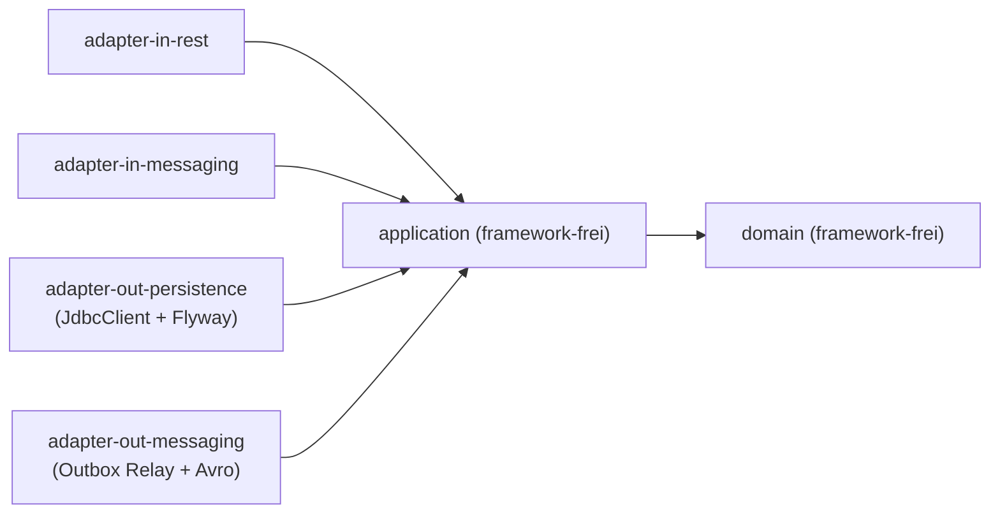

# ledger-stream

Event-getriebenes Buchungssystem in **Java 21** und **Spring Boot 3.5.x**, das messbar zeigt, wie effektive **Exactly-once-Verarbeitung** zwischen PostgreSQL 16 und Apache Kafka (KRaft) über **Transactional Outbox**, **idempotente Consumer** und **klassifiziertes Fehlerhandling mit DLQ & Replay** hergestellt wird.

## Problemstellung

Der schwierige Teil event-getriebener Systeme ist nicht das Produzieren einer Kafka-Nachricht. Die eigentliche Konsistenzaufgabe liegt an der Systemgrenze zwischen relationaler Datenbank und Broker:

- **Absturz nach DB-Commit, vor Kafka-Publish** → Buchung existiert, Event fehlt (Datenverlust im Downstream).
- **Absturz nach Kafka-Publish, vor Bestätigung / Redelivery** → Event kommt mehrfach an (Doppelbuchung ohne Idempotenz).
- **Doppelter Client-Request bei Netzwerk-Timeout** → ohne expliziten `Idempotency-Key` entsteht eine doppelte Buchung.

`ledger-stream` löst diese Probleme explizit und ohne verdeckende Bibliotheken (kein Debezium, kein Spring Cloud Stream, kein Axon, kein Lombok, kein JPA/Hibernate).

## Architektur

Die vollständige Architektur inklusive Hexagonal-Schnitt und End-to-End-Sequenzdiagramm ist in [docs/architecture.md](docs/architecture.md) dokumentiert.



Architekturentscheidungen werden als ADRs unter [`docs/adr/`](docs/adr/) gepflegt (u. a. [ADR-0001: Spring `JdbcClient` statt JPA/Hibernate](docs/adr/0001-jdbcclient-statt-jpa.md)).

## Idempotenz-Semantik (HTTP-API)

Jede schreibende Buchungsoperation (`POST /api/v1/accounts/{id}/bookings`, `POST /api/v1/accounts/{id}/bookings/{bookingId}/cancel`) erfordert den Header `Idempotency-Key` (1–128 Zeichen, eindeutig pro Konto über `UNIQUE (account_id, idempotency_key)`):

1. **Atomare Persistenz der Erfolgsantwort:** Statuscode und serialisierter JSON-Response-Body werden in derselben Datenbanktransaktion wie die Konto- und Buchungsänderung in `idempotency_keys` persistiert.
2. **Byte-gleiches Replay:** Ein wiederholter Request mit demselben `(account_id, idempotency_key)` führt keinen zweiten Buchungseffekt aus und liefert den persistierten HTTP-Status sowie den **byte-identischen** Response-Body zurück (ergänzt um den informativen Header `Idempotency-Replayed: true`).
3. **Nur `2xx` wird gecacht:** Ablehnungen (`400`, `404`, `422`) rollen die Transaktion zurück und werden **nicht** in `idempotency_keys` gespeichert (zusätzlich durch `CHECK (response_status BETWEEN 200 AND 299)` in PostgreSQL erzwungen). Ein korrigierter Retry mit demselben Schlüssel wird danach regulär verarbeitet.
4. **Gleichzeitige Requests mit identischem Schlüssel:** Treffen parallele Requests mit demselben `(account_id, idempotency_key)` ein, gewinnt genau eine Transaktion über den Unique-Index bzw. das optimistische Locking. Verlierer-Requests lesen die gespeicherte Antwort des Gewinners und liefern sie byte-gleich zurück — **kein `409 Conflict`**.

## Schnellstart

```bash
# 1. Lokale Infrastruktur starten (PostgreSQL 16, Kafka 3.9.1 KRaft, Schema Registry)
docker compose up -d --wait

# 2. Build, ArchUnit-Prüfung und Testcontainers-Integrationstests ausführen
./mvnw verify
```

> Hinweis: PostgreSQL in `docker-compose.yml` ist standardmäßig nur innerhalb des Compose-Netzwerks erreichbar (kein Host-Port-Mapping). Alle Integrationstests laufen vollständig isoliert über Testcontainers.

## Lastnachweis (Phase 10)

> Die folgenden Messwerte werden in Phase 10 reproduzierbar mit festem Seed erhoben.
>
> **Klare Trennung der Nachweise:**
> - **Retry-Leiter (5 Versuche, exponentieller Backoff + Jitter):** nachgewiesen über dedizierten Integrationstest (Phase 5), nicht über den Lasttest.
> - **DLQ-Anteil im Lasttest (1 %):** transportseitige Fault Injection (schema-valide Poison-Events mit unbekanntem Konto und `amount <= 0` direkt ins Topic durch `load-generator`), kein Test-Schalter im Produktivcode.

| Gesendet | Akzeptiert | Validierung abgelehnt | Duplikate abgewiesen | DLQ-Einträge | Dauer | Durchsatz | Seed |
|---:|---:|---:|---:|---:|---:|---:|---:|
| _Phase 10_ | _Phase 10_ | _Phase 10_ | _Phase 10_ | _Phase 10_ | _Phase 10_ | _Phase 10_ | _Phase 10_ |
