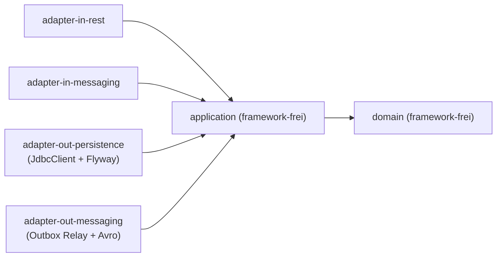

# ledger-stream

Event-getriebenes Buchungssystem in **Java 21** und **Spring Boot 3.5.x**, das messbar zeigt, wie effektive **Exactly-once-Verarbeitung** zwischen PostgreSQL 16 und Apache Kafka (KRaft) über **Transactional Outbox**, **idempotente Consumer** und **klassifiziertes Fehlerhandling mit DLQ & Replay** hergestellt wird.

## Problemstellung

Der schwierige Teil event-getriebener Systeme ist nicht das Produzieren einer Kafka-Nachricht. Die eigentliche Konsistenzaufgabe liegt an der Systemgrenze zwischen relationaler Datenbank und Broker:

- **Absturz nach DB-Commit, vor Kafka-Publish** → Buchung existiert, Event fehlt (Datenverlust im Downstream).
- **Absturz nach Kafka-Publish, vor Bestätigung / Redelivery** → Event kommt mehrfach an (Doppelbuchung ohne Idempotenz).
- **Doppelter Client-Request bei Netzwerk-Timeout** → ohne expliziten `Idempotency-Key` entsteht eine doppelte Buchung.

`ledger-stream` löst diese Probleme explizit und ohne verdeckende Bibliotheken (kein Debezium, kein Spring Cloud Stream, kein Axon, kein Lombok, kein JPA/Hibernate).

## Effektive Exactly-once-Semantik

In einem verteilten System aus PostgreSQL und Kafka existiert kein magisches „Exactly-once-Delivery“ über die Netzwerkgrenze. `ledger-stream` trennt deshalb bewusst drei Schichten:

| Schicht | Garantie | Mechanismus in `ledger-stream` |
|---|---|---|
| **Zustellung (Delivery)** | **At-least-once** | Transactional Outbox (`FOR UPDATE SKIP LOCKED`, Batch 500) publiziert nach Commit; Absturz zwischen Kafka-Ack und `markSent` führt zu erneutem Publish. |
| **Verarbeitung (Processing)** | **At-least-once** | Manuelles Offset-Commit erst nach DB-Commit; Absturz zwischen DB-Commit und Offset-Commit sowie Non-Blocking Retry Topics liefern Records erneut aus. |
| **Wirkung (Effect)** | **Genau einmal (Exactly-once)** | Schreibseite: `UNIQUE (account_id, idempotency_key)` + byte-gleiches Replay gecachter `2xx`-Antworten. Leseseite: `INSERT INTO processed_events ... ON CONFLICT DO NOTHING` in derselben Transaktion wie das `account_summary`-Update. |

## Architektur

Die vollständige Architektur inklusive Hexagonal-Schnitt und End-to-End-Sequenzdiagramm ist in [docs/architecture.md](docs/architecture.md) dokumentiert.



Architekturentscheidungen werden als ADRs unter [`docs/adr/`](docs/adr/) gepflegt:
- [ADR-0001: Spring `JdbcClient` statt JPA/Hibernate](docs/adr/0001-jdbcclient-statt-jpa.md)
- [ADR-0002: Avro-Kompatibilität `FULL` statt `BACKWARD`](docs/adr/0002-avro-full-compatibility-statt-backward.md)
- Bewusste Entwurfsgrenzen (u. a. Per-Account-Reihenfolge bei Non-Blocking Retry-Topics): [docs/design-decisions.md](docs/design-decisions.md)

## Idempotenz-Semantik (HTTP-API)

Jede schreibende Buchungsoperation (`POST /api/v1/accounts/{id}/bookings`, `POST /api/v1/accounts/{id}/bookings/{bookingId}/cancel`) erfordert den Header `Idempotency-Key` (1–128 Zeichen, eindeutig pro Konto über `UNIQUE (account_id, idempotency_key)`):

1. **Atomare Persistenz der Erfolgsantwort:** Statuscode und serialisierter JSON-Response-Body werden in derselben Datenbanktransaktion wie die Konto- und Buchungsänderung in `idempotency_keys` persistiert.
2. **Byte-gleiches Replay:** Ein wiederholter Request mit demselben `(account_id, idempotency_key)` führt keinen zweiten Buchungseffekt aus und liefert den persistierten HTTP-Status sowie den **byte-identischen** Response-Body zurück (ergänzt um den informativen Header `Idempotency-Replayed: true`).
3. **Nur `2xx` wird gecacht:** Ablehnungen (`400`, `404`, `422`) rollen die Transaktion zurück und werden **nicht** in `idempotency_keys` gespeichert (zusätzlich durch `CHECK (response_status BETWEEN 200 AND 299)` in PostgreSQL erzwungen). Ein korrigierter Retry mit demselben Schlüssel wird danach regulär verarbeitet.
4. **Gleichzeitige Requests mit identischem Schlüssel:** Treffen parallele Requests mit demselben `(account_id, idempotency_key)` ein, gewinnt genau eine Transaktion über den Unique-Index bzw. das optimistische Locking. Verlierer-Requests lesen die gespeicherte Antwort des Gewinners und liefern sie byte-gleich zurück — **kein `409 Conflict`**.
5. **Lock-Timeout-Schutz (`lock_timeout = 3s`):** Blockiert ein konkurrierender Request am Unique-Index oder Zeilen-Lock länger als `3s` (z. B. durch eine langsame Gewinner-Transaktion), bricht PostgreSQL mit `SQLSTATE 55P03` ab. Die API übersetzt dies in HTTP **`503 Service Unavailable`** mit Header **`Retry-After: 1`** (RFC 7807 `errorCode: LOCK_TIMEOUT`), sodass kein Request-Thread unbegrenzt hängt.

## Outbox-Betrieb, Metriken & PostgreSQL-Parameter

### Outbox-Alarmierung (Prometheus-Beispiel)

Ein reiner Zähler wie `outbox_unsent` reicht nicht aus, um ein stehendes Relay von normalem Last-Backlog zu unterscheiden. Entscheidend ist das Alter des ältesten `PENDING`-Events (`outbox_oldest_pending_age_seconds`):

```yaml
- alert: OutboxRelayStalled
  expr: outbox_oldest_pending_age_seconds > 300
  for: 1m
  labels:
    severity: critical
  annotations:
    summary: "Outbox-Relay hängt oder ist ausgefallen"
    description: "Ältestes PENDING-Outbox-Event wartet seit > 300s (Wert: {{ $value }}s)."
```

Weitere Outbox-Metriken: `outbox_unsent` (Micrometer: `outbox_unsent_total`), `outbox_events_failed_total` (Events im Status `FAILED` nach `N=10` fehlgeschlagenen Versuchen mit exponentiellem Backoff `1s..60s` ±20 % Jitter).

### Verifizierte PostgreSQL-Parameter (Docker Compose)

Nach Start von `postgres` per `SHOW` bestätigt:

```text
shared_buffers       = 64MB
work_mem             = 4MB
maintenance_work_mem = 32MB
lock_timeout         = 3s
```

## Fehlerbehandlung, Non-Blocking Retry & DLQ

### Warum Retry-Topics (`@RetryableTopic`) statt `DefaultErrorHandler`-Backoff oder Pause/Resume?

- Ein blockierender `DefaultErrorHandler` mit `ExponentialBackOff` schläft direkt im Consumer-Thread und **blockiert alle nachfolgenden Events derselben Partition** — zudem droht bei längeren Backoffs ein Überschreiten von `max.poll.interval.ms` (`300000 ms` = 5 min) und damit ungewollte Consumer-Group-Rebalances.
- Ein manuelles `pause()`/`resume()` auf Partitionsebene stoppt ebenfalls die gesamte Partition (Head-of-Line-Blocking) und verkompliziert Offset-Management sowie Rebalance-Handling erheblich.
- **Retry-Topics (`ledger.events-retry-0..3` → `ledger.events.dlq`)** verschieben fehlerhafte technische Nachrichten sofort asynchron aus dem Haupt-Topic und committen dessen Offset, sodass nachfolgende Nachrichten derselben Partition verzögerungsfrei weiterlaufen und `max.poll.interval.ms` nie gefährdet wird.

### Fehlerklassifikation & Metriken

- **Deserialisierungsfehler & fachliche Fehler** (`unknown_account`, `amount <= 0`, ungültiger Typ): **0 Retries**, direkt in `ledger.events.dlq` und `dlq_entries` unter Beibehaltung der unveränderten Rohbytes (`RawPayloadPreservingAvroDeserializer`, Base64 in Header `x-original-payload`).
- **Technische Fehler** (DB-Ausfall, Timeout, Schreibfehler): nicht-blockierend bis zu **5 Versuche** mit exponentiellem Backoff und Jitter (`random = true`), danach `ledger.events.dlq` + `dlq_entries`.
- **Metriken (`/actuator/prometheus`):**
  - `dlq_entries_unhandled` (Gauge): offene DLQ-Einträge (`replayed_at IS NULL`) — Zielwert `0`, maßgeblich für Alarmierung.
  - `dlq_replayed_total` (Counter): über `POST /admin/dlq/{id}/replay` erneut eingestellte Einträge.
  - `consumer_retries_total` (Counter): ausgelöste nicht-blockierende Retry-Versuche (Frühindikator vor DLQ-Wachstum).
- **Admin-Endpunkte abgesichert (Phase 7):** `GET /admin/dlq` und `POST /admin/dlq/{id}/replay` erfordern `ledger.admin.enabled=true` **und** ein gültiges OIDC-Token mit Rolle `operator` (`ROLE_operator`). Standardmäßig (`ledger.admin.enabled=false`, auch im k3s-Overlay [deploy/kustomize/overlays/prod/kustomization.yaml](deploy/kustomize/overlays/prod/kustomization.yaml) explizit gepinnt) liefern sie `404` vor `401`.
- **Zwei unabhängige Replay-Garantien & unveränderliche Replay-Historie:** Ein erneuter Replay eines bereits wieder eingespielten DLQ-Eintrags wird an der Admin-API über den `replayed_at`-Guard mit HTTP **`409 Conflict`** abgewiesen; selbst bei einem manuellen Re-Publish am Admin-Endpunkt vorbei verhindert `UNIQUE (event_id)` auf `processed_events` eine doppelte Buchungswirkung. Jeder Replay-Versuch wird unveränderlich in `dlq_replay_attempts` protokolliert; scheitert ein Replay erneut oder trifft derselbe unlesbare Deserialisierungs-Poison mehrfach ein, dedupliziert der Partial-Unique-Index `uq_dlq_entries_unhandled_dedup_key` auf `COALESCE(event_id::text, payload_sha256) WHERE replayed_at IS NULL` in eine einzige offene Zeile und erhöht `attempt_count`.
- Vollständiges Runbook (Analyse, Replay-Kriterien, Begründung Outbox `10` vs. Consumer `5` Retries): [docs/operations.md](docs/operations.md).

## Security (Keycloak 26 + OIDC Resource Server)

### Rollenmodell (Least Privilege)

| Rolle | Authority | Erlaubte Endpunkte | Bewusst verweigert (`403`) |
|---|---|---|---|
| `viewer` | `ROLE_viewer` | `GET /api/v1/accounts/**` | `POST /api/v1/accounts/**`, `/admin/dlq/**` |
| `writer` | `ROLE_writer` | `GET` & `POST /api/v1/accounts/**` (Kontoanlage, Buchung, Storno) | `/admin/dlq/**` |
| `operator` | `ROLE_operator` | `GET` & `POST /api/v1/accounts/**` sowie `/admin/dlq/**` (bei `ledger.admin.enabled=true`) | — |

**Entscheidung:** Drei Rollen statt zwei — Buchungs-Clients (`writer`) können geschäftliche Buchungen ausführen, dürfen aber niemals DLQ-Payloads inspizieren oder Replays auslösen (`Separation of Duties`).

### Durchsetzung & Härtung

- **404-vor-401:** Ist `ledger.admin.enabled=false` (Default), nimmt eine `@Order(1)`-`SecurityFilterChain` den Pfad `/admin/**` vor der OIDC-Prüfung heraus; ohne `DlqAdminController` antwortet Spring konsistent mit **`404 Not Found`** (unauthentifiziert, als `viewer` und als `operator`), ohne die Existenz der Admin-Route zu verraten.
- **Explizite Token-Prüfung:** `JwtAuthenticationConverter` mappt `realm_access.roles` explizit auf `ROLE_*`. Der `NimbusJwtDecoder` prüft Signatur über JWKS (kein `alg=none`, kein fremder Key), `exp`/`nbf`, `iss` sowie explizit `aud = ledger-stream-api`. `401` und `403` liefern strukturierte RFC-7807-Antworten (`application/problem+json`).
- **Keine Secrets im Repository:** [keycloak/realm-export.json](keycloak/realm-export.json) enthält den Public-PKCE-Client `ledger-stream-spa` (`S256`, ohne Secret) für Phase 8 sowie den vertraulichen Client `ledger-stream-cli` mit Platzhalter `${LEDGER_CLI_CLIENT_SECRET}` (Injektion per Env / Kubernetes `secretKeyRef` in [deploy/kustomize/base/keycloak-deployment.yaml](deploy/kustomize/base/keycloak-deployment.yaml)).

## Ressourcenbudget (gemessene `docker stats` nach Phase 7)

Keycloak 26 läuft mit `start --optimized --import-realm`, `-Xmx256m`, `KC_CACHE=local` auf der **bestehenden** PostgreSQL-16-Instanz (eigene Datenbank `keycloak`, kein H2, kein Dev-Mode, kein zweiter Postgres-Container).

| Container | Limit | Tuning | Gemessener RSS | Auslastung |
|---|---:|---|---:|---:|
| `ledger-stream-postgres` | `320 MiB` | `shared_buffers=64MB`, `work_mem=4MB`, `lock_timeout=3s` (DBs: `ledger` + `keycloak`) | `45,84 MiB` | `14,33 %` |
| `ledger-stream-kafka` | `448 MiB` | KRaft, `-Xms128m -Xmx192m`, `dedupe_buffer=16MB` | `202,20 MiB` | `45,13 %` |
| `ledger-stream-schema-registry` | `384 MiB` | `FULL`, `-Xmx192m -XX:MaxMetaspaceSize=96m` | `201,20 MiB` | `52,39 %` |
| `ledger-stream-keycloak` | `512 MiB` | `start --optimized`, `KC_DB=postgres`, `KC_CACHE=local`, `-Xms128m -Xmx256m` | `400,20 MiB` | `78,17 %` |
| **Summe Infrastruktur (4 Container)** | — | **Zielbudget Gesamtstack: `1536 MiB` (1,5 GiB)** | **`849,44 MiB`** | **Puffer: `686,56 MiB`** |

## Schema-Evolution (Avro + Confluent Schema Registry)

- **Kompatibilitätsstufe:** `FULL` (beidseitig: v2-Consumer liest v1-Daten **und** v1-Consumer liest v2-Daten; Begründung gegenüber `BACKWARD` und `FULL_TRANSITIVE` in [ADR-0002](docs/adr/0002-avro-full-compatibility-statt-backward.md)).
- **Evolution v1 → v2 (`LedgerBookingEvent.avsc`):** Neues optionales Feld `initiationChannel` (`"type": "string", "default": "API"`). Beim Lesen älterer v1-Nachrichten löst der Consumer den nicht-null Default `"API"` auf; `schemaVersion = 2` im Payload korrespondiert mit der v2-Schema-ID im 5-Byte Confluent-Wire-Header.
- **CI-Erzwingung:** `SchemaEvolutionIT` prüft im CI-Build gegen eine echte Schema Registry (`confluentinc/cp-schema-registry:7.9.9`) die `FULL`-Konfiguration, beide Leserichtungen, die Ablehnung eines inkompatiblen Schemas (Pflichtfeld ohne Default → HTTP `409`) sowie byte-gleiche Rohbytes bei DLQ-Replay von v2-Events. Der CI-Workflow bricht ab, falls `SchemaEvolutionIT` nicht mit 0 Skips läuft.

## Schnellstart

```bash
# 1. Lokale Infrastruktur starten (PostgreSQL 16, Kafka 3.9.1 KRaft, Schema Registry)
docker compose up -d --wait

# 2. Build, ArchUnit-Prüfung und Testcontainers-Integrationstests ausführen
./mvnw verify
```

> Hinweis: PostgreSQL in `docker-compose.yml` ist standardmäßig nur innerhalb des Compose-Netzwerks erreichbar (kein Host-Port-Mapping). Alle Integrationstests laufen vollständig isoliert über Testcontainers.

## Lastnachweis (Phase 10)

> Die folgenden Messwerte werden in Phase 10 reproduzierbar mit festem Seed erhoben.
>
> **Klare Trennung der Nachweise:**
> - **Retry-Leiter (5 Versuche, exponentieller Backoff + Jitter):** nachgewiesen über dedizierten Integrationstest (Phase 5), nicht über den Lasttest.
> - **DLQ-Anteil im Lasttest (1 %):** transportseitige Fault Injection (schema-valide Poison-Events mit unbekanntem Konto und `amount <= 0` direkt ins Topic durch `load-generator`), kein Test-Schalter im Produktivcode.

| Gesendet | Akzeptiert | Validierung abgelehnt | Duplikate abgewiesen | DLQ-Einträge | Dauer | Durchsatz | Seed |
|---:|---:|---:|---:|---:|---:|---:|---:|
| _Phase 10_ | _Phase 10_ | _Phase 10_ | _Phase 10_ | _Phase 10_ | _Phase 10_ | _Phase 10_ | _Phase 10_ |
