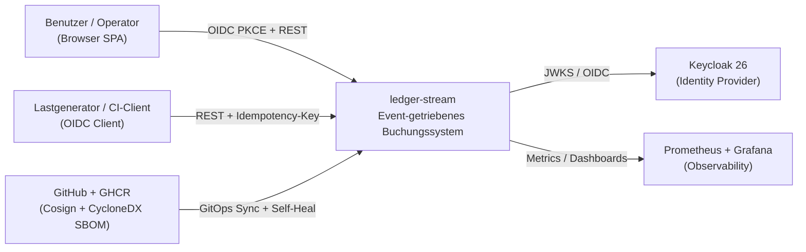
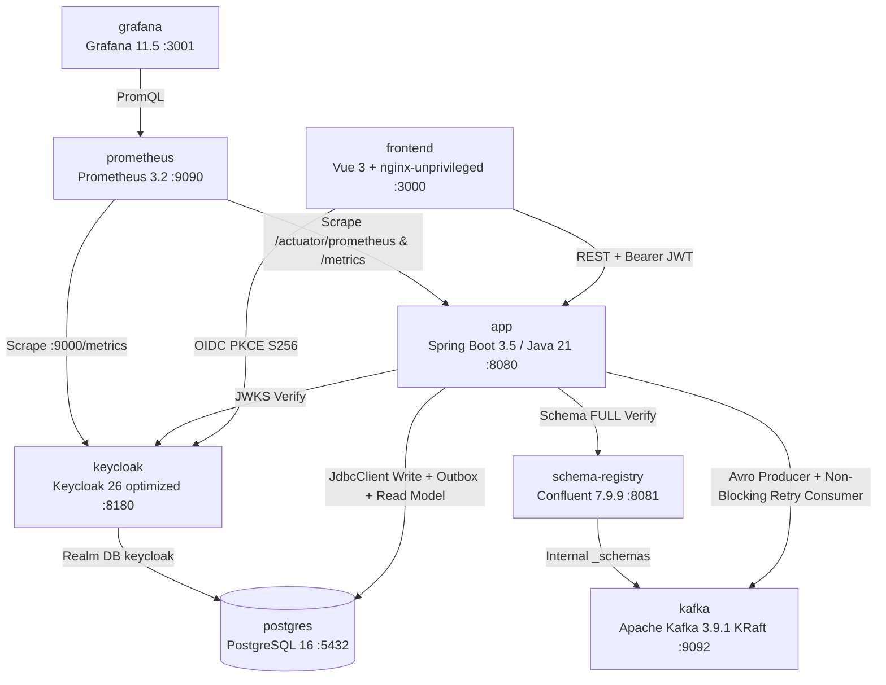

# ledger-stream

## Problem → Lösung (in 5 Sätzen)

In event-getriebenen Buchungssystemen liegt das eigentliche Konsistenzproblem an der Systemgrenze zwischen relationaler Datenbank und Kafka-Broker: Stürzt der Service nach dem DB-Commit und vor dem Broker-Publish ab, gehen Events verloren; bei Redelivery oder doppelten Client-Requests drohen Doppelbuchungen. `ledger-stream` löst diese Lücke mit **Java 21**, **Spring Boot 3.5.x**, **PostgreSQL 16** und **Apache Kafka 3.9.1 (KRaft)** ohne verdeckende Frameworks (kein Debezium, kein Spring Cloud Stream, kein JPA/Hibernate, kein Lombok). Jede Buchung schreibt Kontoänderung, gecachte Idempotenz-Antwort (`UNIQUE (account_id, idempotency_key)` + SHA-256-Payload-Fingerprint) und Outbox-Event atomar in derselben Datenbanktransaktion; ein Outbox-Relay publiziert per `FOR UPDATE SKIP LOCKED` mindestens einmal nach Kafka. Auf der Leseseite dedupliziert der Consumer über `INSERT INTO processed_events ... ON CONFLICT DO NOTHING` in derselben Transaktion wie das Saldo-Update, während technische Fehler über nicht-blockierende Retry-Topics und fachliche/Deserialisierungs-Fehler mit erhaltenen Rohbytes direkt in die DLQ (`ledger.events.dlq` + `dlq_entries`) laufen. Die vollständige Wirkung — inklusive Security (Keycloak 26 OIDC), Observability (Prometheus/Grafana), reproduzierbarem 100.000-Buchungen-Lasttest und GitOps-Deployment (k3s, Kustomize, ArgoCD, Cosign/SBOM) — ist über automatisierte Integrationstests und harte DB-Invarianten nachgewiesen.

## Architektur (Kontext & Container)

Die vollständige Architektur inklusive Hexagonal-Schnitt und End-to-End-Sequenzdiagramm liegt in [docs/architecture.md](docs/architecture.md).

### Systemkontext



### Container-Architektur



### Architekturentscheidungen & Dokumentation

- **Architecture Decision Records ([`docs/adr/`](docs/adr/)):**
  - [ADR-0001: Transactional Outbox statt 2PC/XA](docs/adr/0001-transactional-outbox-statt-2pc-xa.md)
  - [ADR-0002: At-least-once + Consumer-Idempotenz statt Kafka-Transaktionen](docs/adr/0002-at-least-once-idempotenz-statt-kafka-transaktionen.md)
  - [ADR-0003: Spring `JdbcClient` statt JPA/Hibernate](docs/adr/0003-jdbcclient-statt-jpa.md)
  - [ADR-0004: Apache Kafka KRaft Single-Broker statt Multi-Broker/ZooKeeper](docs/adr/0004-kraft-single-broker.md)
  - [ADR-0005: Avro-Kompatibilität `FULL` statt `BACKWARD`](docs/adr/0005-avro-full-compatibility-statt-backward.md)
  - [ADR-0006: Non-Blocking Retry-Topics (`@RetryableTopic`) statt Pause/Resume oder blockierendem Backoff](docs/adr/0006-retry-topics-statt-pause-resume.md)
  - [ADR-0007: Keycloak 26 statt Spring Authorization Server](docs/adr/0007-keycloak-statt-spring-authorization-server.md)
  - [ADR-0008: Kustomize statt Helm](docs/adr/0008-kustomize-statt-helm.md)
  - [ADR-0009: Ressourcenbudget als Designzwang](docs/adr/0009-ressourcenbudget-als-designzwang.md)
  - [ADR-0010: Effektive Exactly-once-Terminologie](docs/adr/0010-effektive-exactly-once-terminologie.md)
- **Bewusste Trade-offs & Systemgrenzen:** [docs/design-decisions.md](docs/design-decisions.md)
- **Betriebs-Runbook (Outbox, DLQ, Rollback, Broker-Ausfall, Skalierung):** [docs/operations.md](docs/operations.md)
- **Detail-Architektur (Hexagonal & End-to-End-Sequenz):** [docs/architecture.md](docs/architecture.md)

## Schnellstart

```bash
# 1. Kompletten lokalen Stack starten (PostgreSQL 16, Kafka 3.9.1 KRaft, Schema Registry,
#    Keycloak 26, App, Frontend, Prometheus, Grafana)
docker compose up -d --wait

# 2. Backend bauen, ArchUnit-Regeln und Testcontainers-Integrationstests ausführen
./mvnw verify

# 3. Frontend-Tests, TypeScript-Check und ESLint ausführen
npm --prefix frontend ci && npm --prefix frontend run typecheck && npm --prefix frontend run lint && npm --prefix frontend test
```

### Lokale Endpunkte & Zugang (`docker-compose.yml`)

| Dienst | URL | Zweck / Zugang |
|---|---|---|
| **Frontend (SPA)** | `http://localhost:3000` | Vue-3-UI mit OIDC PKCE (`S256`) gegen Realm `ledger-stream` |
| **Backend API & Actuator** | `http://localhost:8080` | REST API (`/api/v1/accounts/**`), Health (`/actuator/health`), Metriken (`/actuator/prometheus`) |
| **Keycloak 26** | `http://localhost:8180` | Realm `ledger-stream` (Demo-User aus `keycloak/realm-export.json`: `viewer`/`viewer`, `writer`/`writer`, `operator`/`operator`) |
| **Prometheus** | `http://localhost:9090` | Metrik-Abfragen (Scrape-Targets: `app:8080`, `keycloak:9000`) |
| **Grafana** | `http://localhost:3001` | Zero-Click-Dashboard `ledger-stream-overview` (`admin` / Env `GRAFANA_ADMIN_PASSWORD`, lokal Default `admin`) |

> **Hinweise:** PostgreSQL (`5432`) ist in `docker-compose.yml` bewusst nicht auf den Host gemappt. Alle Integrationstests laufen vollständig isoliert gegen Testcontainers. Der vertrauliche Keycloak-Client `ledger-stream-cli` (`directAccessGrantsEnabled=true`) in [keycloak/realm-export.json](keycloak/realm-export.json) dient ausschließlich als Test- und Lastgenerator-Infrastruktur; produktive Browser-Logins nutzen ausschließlich den Public-PKCE-Client `ledger-stream-spa`.

## Effektive Exactly-once-Semantik

In einem verteilten System aus PostgreSQL und Kafka existiert kein „Exactly-once-Delivery“ über die Netzwerkgrenze. `ledger-stream` trennt deshalb explizit drei Schichten (Begründung in [ADR-0010](docs/adr/0010-effektive-exactly-once-terminologie.md)):

> Kafka liefert at-least-once, der Consumer dedupliziert über `event_id` in derselben Transaktion wie das Saldo-Update. Die Wirkung tritt genau einmal ein — nachweisbar im Lasttest: Summe der Buchungen = akzeptierte Anfragen, bei 5 % Duplikaten.

| Schicht | Garantie | Mechanismus in `ledger-stream` | Nachweis |
|---|---|---|---|
| **Zustellung (Delivery)** | **At-least-once** | Transactional Outbox (`FOR UPDATE SKIP LOCKED`, Batch `500`, `200 ms` Intervall) publiziert nach Commit; Crash zwischen Broker-Ack und `markSent` führt zu erneutem Publish. | [`TransactionalOutboxIT`](app/src/test/java/io/ledgerstream/app/TransactionalOutboxIT.java), [`OutboxRelayServiceTest`](application/src/test/java/io/ledgerstream/application/service/OutboxRelayServiceTest.java) |
| **Verarbeitung (Processing)** | **At-least-once** | Manuelles Offset-Commit erst nach DB-Commit; Crash zwischen DB-Commit und Offset-Commit sowie Non-Blocking Retry-Topics liefern Records erneut aus. | [`IdempotentConsumerIT`](app/src/test/java/io/ledgerstream/app/IdempotentConsumerIT.java), [`DlqAndRetryIT`](app/src/test/java/io/ledgerstream/app/DlqAndRetryIT.java) |
| **Wirkung (Effect)** | **Genau einmal (Exactly-once)** | Schreibseite: `UNIQUE (account_id, idempotency_key)` + SHA-256-Payload-Fingerprint + byte-gleiches Replay gecachter `2xx`-Antworten. Leseseite: `INSERT INTO processed_events ... ON CONFLICT DO NOTHING` in derselben Transaktion wie das `account_summary`-Update. | [`AccountBookingApiIT`](app/src/test/java/io/ledgerstream/app/AccountBookingApiIT.java), [`IdempotentConsumerIT`](app/src/test/java/io/ledgerstream/app/IdempotentConsumerIT.java), [`InvariantChecker`](load-generator/src/main/java/io/ledgerstream/loadgen/InvariantChecker.java) |

## Idempotenz-Semantik, Fehlerbehandlung & Security

### HTTP-Idempotenz (`Idempotency-Key` + Payload-Fingerprint)

Jede schreibende Operation (`POST /api/v1/accounts/{id}/bookings`, `POST /api/v1/accounts/{id}/bookings/{bookingId}/cancel`) erfordert `Idempotency-Key` (`1–128` Zeichen, `UNIQUE (account_id, idempotency_key)`):

- **Gleicher Key + gleicher Inhalt:** Atomar persistierte `2xx`-Antwort wird byte-identisch mit Header `Idempotency-Replayed: true` zurückgeliefert; keine zweite Buchung, kein zweites Kafka-Event ([`AccountBookingApiIT`](app/src/test/java/io/ledgerstream/app/AccountBookingApiIT.java)).
- **Gleicher Key + anderer Inhalt (`request_fingerprint` ≠ SHA-256 der kanonischen Felder `accountId`, `type`, normalisierter `amount`, `currency`, `reference`):** HTTP **`422 Unprocessable Entity`** (RFC 7807 `urn:ledger-stream:error:idempotency-key-reuse`), keine zweite Buchung, Saldo unverändert ([`AccountBookingApiIT`](app/src/test/java/io/ledgerstream/app/AccountBookingApiIT.java)).
- **Abgrenzung `409` / `503` vs. `422`:** Paralleler Konflikt beim Optimistic Locking liefert `409 Conflict`; überschreitet ein Lock-Wait `lock_timeout = 3s` (`SQLSTATE 55P03`), liefert die API `503 Service Unavailable` + `Retry-After: 1` (`4xx`/`5xx` werden per `CHECK (response_status BETWEEN 200 AND 299)` niemals gecacht).

### Non-Blocking Retry, DLQ & Schema-Evolution

- **Fehlerklassifikation:** Deserialisierungsfehler und fachliche Fehler (`unknown_account`, `amount <= 0`, ungültiger Typ) erhalten **0 Retries** und landen direkt in `ledger.events.dlq` + `dlq_entries` unter Beibehaltung der unveränderten Rohbytes (`RawPayloadPreservingAvroDeserializer`, Base64 in `x-original-payload`, verifiziert in [`RawPayloadPreservingAvroDeserializerTest`](adapter-in-messaging/src/test/java/io/ledgerstream/adapter/in/messaging/RawPayloadPreservingAvroDeserializerTest.java) und [`DlqAndRetryIT`](app/src/test/java/io/ledgerstream/app/DlqAndRetryIT.java)). Technische Fehler durchlaufen bis zu **5 nicht-blockierende Versuche** über Retry-Topics (`ledger.events-retry-0..3`) mit exponentiellem Backoff + Jitter ([`DlqAndRetryIT`](app/src/test/java/io/ledgerstream/app/DlqAndRetryIT.java), [ADR-0006](docs/adr/0006-retry-topics-statt-pause-resume.md)).
- **Retry-Topic-Thread-Trade-off (F4):** `6` Partitionen × `6` Topics (Haupt-Topic + `4` Retry-Topics + DLQ) erzeugen **`36` Consumer-Threads**. Laut `jcmd VM.native_memory summary` im 100k-Peak macht deren Thread-Stack nur ca. **`3,7 MiB`** aus (von `18,3 MiB` über alle `178` JVM-Threads); es handelt sich primär um einen **CPU-/Context-Switch-Trade-off**, nicht um ein RAM-Problem. Eine Reduktion auf `2` Retry-Stufen (`18` Threads, über `KAFKA_RETRY_MAX_ATTEMPTS`) spart Context-Switches bei leicht gröberer Backoff-Staffelung (Details in [ADR-0006](docs/adr/0006-retry-topics-statt-pause-resume.md) und [docs/design-decisions.md](docs/design-decisions.md)).
- **DLQ-Wiedereintritt & unveränderliche Replay-Historie:** Jeder Replay-Versuch wird unveränderlich in `dlq_replay_attempts` protokolliert; erneute Fehlschläge oder wiederholte unlesbare Poisons dedupliziert der Partial-Unique-Index `uq_dlq_entries_unhandled_dedup_key` auf `COALESCE(event_id::text, payload_sha256) WHERE replayed_at IS NULL` (erhöht `attempt_count` statt eine zweite offene Zeile anzulegen, verifiziert in [`DlqAndRetryIT`](app/src/test/java/io/ledgerstream/app/DlqAndRetryIT.java)).
- **Schema-Evolution (`FULL`):** `LedgerBookingEvent.avsc` v1 → v2 ergänzt `initiationChannel` mit Default `"API"`. Kompatibilitätsstufe `FULL` (beidseitig v1↔v2) ist in der Registry konfiguriert und im CI gegen `confluentinc/cp-schema-registry:7.9.9` getestet ([`SchemaEvolutionIT`](app/src/test/java/io/ledgerstream/app/SchemaEvolutionIT.java), [ADR-0005](docs/adr/0005-avro-full-compatibility-statt-backward.md)).

### Security, Frontend & Observability

- **OIDC-RBAC (Least Privilege):** Drei Allowlist-Rollen (`viewer` → `GET /api/v1/**`, `writer` → `GET`/`POST /api/v1/**`, `operator` → zusätzlich `/admin/dlq/**` bei `ledger.admin.enabled=true`); technische Keycloak-Rollen (`default-roles-*`, `offline_access`, `uma_authorization`) werden verworfen ([`KeycloakSecurityIT`](app/src/test/java/io/ledgerstream/app/KeycloakSecurityIT.java), [`SecurityNegativeJwtIT`](app/src/test/java/io/ledgerstream/app/SecurityNegativeJwtIT.java)). Ist `ledger.admin.enabled=false` (Default und in [`overlays/prod`](deploy/kustomize/overlays/prod/kustomization.yaml) gepinnt), liefert jede Route unter `/admin/**` **`404` vor `401`** ([`AdminPathInvariantDisabledIT`](app/src/test/java/io/ledgerstream/app/AdminPathInvariantDisabledIT.java), [`AdminPathInvariantEnabledIT`](app/src/test/java/io/ledgerstream/app/AdminPathInvariantEnabledIT.java)). JWT-Signatur, `exp`/`nbf`, `iss`, `aud = ledger-stream-api` und CORS-Allowlist sind negativ getestet ([`SecurityNegativeJwtIT`](app/src/test/java/io/ledgerstream/app/SecurityNegativeJwtIT.java)).
- **Frontend (Vue 3 + TypeScript strict):** `Idempotency-Key` entsteht beim Formular-Öffnen (`useBookingForm.ts`), Submit-Button bleibt klickbar mit Spinner + „Absichtlich doppelt senden (2× parallel)“, Geldbeträge laufen durchgängig als String (`money.ts`, 0 `any`, 0 `as unknown as X`, verifiziert via `Vitest` in `frontend/src/**/*.spec.ts`).
- **Observability:** Geschlossene Micrometer-Kardinalität auf `/actuator/prometheus` (inkl. `outbox_oldest_pending_age_seconds`, `consumer_poison_total`, `consumer_duplicates_rejected_total{reason="duplicate"}`, `dlq_entries_unhandled`, `http_server_requests_seconds`), strukturiertes JSON-Logging mit strikt validierter `X-Correlation-Id` (`^[A-Za-z0-9._-]{8,64}$`) über HTTP → Outbox → Kafka → Consumer → DLQ-Replay ([`ObservabilityAndCorrelationIT`](app/src/test/java/io/ledgerstream/app/ObservabilityAndCorrelationIT.java)), Zero-Click-Grafana-Dashboard [`observability/grafana/dashboards/ledger-stream.json`](observability/grafana/dashboards/ledger-stream.json) (`uid: ledger-stream-overview`, 8 Panels inkl. p95/p99 und 300s-Outbox-Schwelle).

## Lastnachweis (100.000 Buchungen, reproduzierbar)

> **Klare Trennung der Nachweise:**
> - **5 % Duplikate (L2):** Echte Replays bereits akzeptierter Anfragen aus einem Ringpuffer (`Idempotency-Key` + identischer Payload → `201 Created` + `Idempotency-Replayed: true`, byte-gleicher Body, kein zweites Kafka-Event → `consumer_duplicates_rejected_total{reason="duplicate"} == 0`). Die Consumer-seitige Idempotenz (`UNIQUE(event_id)`) ist separat in [`IdempotentConsumerIT`](app/src/test/java/io/ledgerstream/app/IdempotentConsumerIT.java) nachgewiesen.
> - **1 % DLQ (Fault Injection):** Schema-valide Avro-v2-Poison-Events (`500` `unknown_account` + `500` `non_positive_amount`) direkt ins Topic `ledger.events` durch [`load-generator`](load-generator/src/main/java/io/ledgerstream/loadgen/LoadGeneratorMain.java) — kein Test-Schalter im Produktivcode.
> - **Retry-Leiter (5 Versuche, Backoff + Jitter):** Nachgewiesen in [`DlqAndRetryIT`](app/src/test/java/io/ledgerstream/app/DlqAndRetryIT.java), nicht im Lasttest.
> - **Warmup:** Erste `5 s` gegen dedizierte Warmup-Konten, aus Durchsatz und Latenz ausgeschlossen (in den DB-Gesamtinvarianten in [`InvariantChecker`](load-generator/src/main/java/io/ledgerstream/loadgen/InvariantChecker.java) jedoch exakt mitgeprüft).

### Umgebung & Reproduzierbarkeits-Parameter

| Parameter | Wert (Quelle) |
|---|---|
| **Host-Hardware** | Intel Core Ultra 7 155H (`22` vCPU / 11 Kerne × 2 Threads), `31 GiB` RAM, `1 TB` virtuelle Disk (`/dev/sdd`), virtualisiert (`WSL2` / Microsoft Hypervisor) |
| **Container-Profile** | Unconstrained: [`docker-compose.loadtest.yml`](docker-compose.loadtest.yml) · 1,5 vCPU rebalanced (F1): [`docker-compose.loadtest-1.5vcpu.yml`](docker-compose.loadtest-1.5vcpu.yml) |
| **App-JVM** | `eclipse-temurin:21-jre-alpine`, `JAVA_OPTS="-XX:MaxRAMPercentage=60.0 -XX:+UseG1GC -XX:+ExitOnOutOfMemoryError"` (`512 MiB` Compose-Limit) |
| **Client-JVM** | `OpenJDK 25.0.2 LTS (Corretto-25.0.2.10.1)` (kompiliert mit `--release 21`), `-Djdk.httpclient.keepalive.timeout=60` |
| **Kafka & Consumer** | `ledger.events`: `6` Partitionen, `ledger.events.dlq`: `6` Partitionen, `KAFKA_CONSUMER_CONCURRENCY=6` ([`KafkaTopicProperties`](adapter-out-messaging/src/main/java/io/ledgerstream/adapter/out/messaging/KafkaTopicProperties.java)) |
| **Outbox-Relay** | Batch `500`, Poll-Intervall `200 ms` (`OUTBOX_RELAY_FIXED_DELAY_MS=200`, theoretischer Deckel `2.500 Events/s`, Wave-Pipelining je Konto; [`OutboxRelayService`](application/src/main/java/io/ledgerstream/application/service/OutboxRelayService.java)) |
| **Client & Aufruf** | `load-generator` CLI (ohne Spring), `--threads=32`, `128` Benchmark-Konten, `--seed=20261124`: `java -Djdk.httpclient.keepalive.timeout=60 -jar load-generator/target/load-generator-0.1.0-SNAPSHOT-shaded.jar --bookings=100000 --duplicates=0.05 --poison=0.01 --seed=20261124 --threads=32 --warmup-seconds=5 --base-url=http://127.0.0.1:8085` |

### Ergebnisse aller drei 100k-Läufe (Seed `20261124`, jeweils [`InvariantChecker`](load-generator/src/main/java/io/ledgerstream/loadgen/InvariantChecker.java))

| Profil | Gesendet (Reg / Dup / Poison) | Akzeptiert (DB-Diff) | L2-Replays (Mismatch) | Consumer-Dup (`reason="duplicate"`) | DLQ / Poison (Diff) | `max(outbox_unsent)` | HTTP-Dauer (ohne 5s Warmup) | Drain (Gesamt) | Durchsatz HTTP (akzept. Buch./s) | Durchsatz Consumer (Prom) | `anon`-Peak (8 Container) | Invariante |
|---|---:|---:|---:|---:|---:|---:|---:|---:|---:|---:|---:|---|
| **Unconstrained** (`docker-compose.loadtest.yml`) | `106.000` (`100k`/`5k`/`1k`) | `100.000` (`0`) | `5.000` (`0`) | `0` | `1.000` (`0`) | `8.549` | `93,97 s` | `103,35 s` (`197,32 s`) | `1064,2 /s` (`1117,4` HTTP/s) | `659,2 /s` (`2m`) | **`1515,87 MiB`** (`-20,13` unter 1536) | **PASS** (`EXIT 0`, 10/10 Konten) |
| **1,5 vCPU initial** (`app 0.60`, `pg 0.35`, `kf 0.25`, `sr 0.15`, `kc 0.10`, `rest 0.05`) | `106.000` (`100k`/`5k`/`1k`) | `100.000` (`0`) | `5.000` (`0`) | `0` | `1.000` (`0`) | `899` | `998,03 s` | `278,64 s` (`1276,67 s`) | `100,2 /s` (`105,2` HTTP/s) | `254,2 /s` (`5m`) | `1662,00 MiB` (`+126,00` über 1536) | **PASS** (`EXIT 0`, 10/10 Konten) |
| **1,5 vCPU rebalanced (F1)** (`app 0.50`, `kc 0.30` `-Xmx224m`, `pg 0.35`, `kf 0.20`, `sr 0.10`, `rest 0.05`) | `106.000` (`100k`/`5k`/`1k`) | `100.000` (`0`) | `5.000` (`0`) | `0` | `1.000` (`0`) | `1.320` | `1178,78 s` | `280,56 s` (`1459,34 s`) | `84,8 /s` (`89,1` HTTP/s) | `249,8 /s` (`5m`) | **`1637,44 MiB`** (`+101,44` über 1536) | **PASS** (`EXIT 0`, 10/10 Konten) |

### Latenzvergleich: Client (`load-generator`) vs. Server (Prometheus `http_server_requests_seconds`)

| Profil | Messpunkt | p50 | p95 | p99 |
|---|---|---:|---:|---:|
| **Unconstrained** | Client (regulär / alle HTTP) | `22,94 ms` / `22,44 ms` | `60,85 ms` / `60,39 ms` | `92,27 ms` / `91,27 ms` |
| **Unconstrained** | Server (Prometheus `5m`) | `16,47 ms` | `49,91 ms` | `79,19 ms` |
| **1,5 vCPU initial** | Client (regulär / alle HTTP) | `276,29 ms` / `231,83 ms` | `694,04 ms` / `691,09 ms` | `1053,07 ms` / `1012,74 ms` |
| **1,5 vCPU initial** | Server (Prometheus `5m`) | `197,36 ms` | `411,35 ms` | `528,83 ms` |
| **1,5 vCPU rebalanced (F1)** | Client (regulär / alle HTTP) | `300,44 ms` / `299,90 ms` | `800,18 ms` / `799,50 ms` | `1297,53 ms` / `1291,18 ms` |
| **1,5 vCPU rebalanced (F1)** | Server (Prometheus `5m`) | `215,49 ms` | `446,02 ms` | `582,74 ms` |

> **Determinismus-Nachweis (`Seed 20261124`):** Alle drei Läufe liefern auf frisch zurückgesetzten Stacks centgenau identische Endsalden auf allen 10 Stichprobenkonten (`DE-BENCH-1352904-0000 = 11737.39 EUR` bis `DE-BENCH-1352904-0009 = 12112.79 EUR`, jeweils `782/782` Buchungen; geprüft in [`InvariantChecker`](load-generator/src/main/java/io/ledgerstream/loadgen/InvariantChecker.java)).

## Ressourcenbudget & Speicher-Aufteilung (F1, F2, F3)

> **Ehrliche Budget-Korrektur (F1/F2):** Die ursprüngliche Zielvorgabe (`1,5 GiB` RAM + `1,5 vCPU` für alle 8 Container) wird im **Unconstrained**-Lauf beim RAM gehalten (`anon = 1515,87 MiB`, `+20,13 MiB` Luft zu `1536 MiB`), nicht aber bei der CPU. Unter harter **`1,5 vCPU`**-Drosselung senkt die Umverteilung auf `keycloak 0.30 vCPU` + `-Xmx224m` (F1) den Keycloak-Working-Set um `35,05 MiB` (von `508,87` auf `473,82 MiB`), doch die reale Summe aller 8 Container unter `1,5 vCPU` bleibt bei **`1637,44 MiB` `anon`** (`+101,44 MiB` über `1536 MiB`; Kern-6 ohne Prometheus/Grafana: `1544,14 MiB`). Statt beide Kriterien gleichzeitig zu behaupten, korrigieren wir das k3s-Budget ehrlich auf **`1792Mi` (`1,75 GiB`) `requests.memory`** (`1728Mi` belegt) und exakt **`1500m` (`1,50 vCPU`) `requests.cpu`** ([`resource-quota.yaml`](deploy/kustomize/base/resource-quota.yaml), [ADR-0009](docs/adr/0009-ressourcenbudget-als-designzwang.md)).

### Cgroup-v2-Speicheraufteilung im 100k-Peak (F1 rebalanced `1,5 vCPU`, `/sys/fs/cgroup/memory.stat`)

Jede Zeile erfüllt exakt `anon + file + Kernel/Rest == memory.current` (F3):

| Container | k3s `requests` (RAM / CPU) | k3s `limits` (RAM / CPU) | `memory.current` | davon `anon` (Working-Set) | davon `file` (reclaimbar) | davon `kernel` (`slab`) | Kernel+Rest (`total-anon-file`) |
|---|---|---|---:|---:|---:|---:|---:|
| `postgres` | `96Mi` / `350m` | `320Mi` / `500m` | `319,36 MiB` | `61,49 MiB` | `236,09 MiB` | `17,93` (`10,88`) | `21,77 MiB` |
| `kafka` | `288Mi` / `200m` | `448Mi` / `500m` | `372,33 MiB` | `277,84 MiB` | `86,11 MiB` | `7,22` (`4,42`) | `8,38 MiB` |
| `schema-registry` | `224Mi` / `100m` | `384Mi` / `250m` | `239,32 MiB` | `223,63 MiB` | `10,75 MiB` | `4,18` (`2,43`) | `4,94 MiB` |
| `keycloak` | `480Mi` / `300m` | `640Mi` / `500m` | `492,07 MiB` | `473,82 MiB` | `11,99 MiB` | `4,52` (`1,87`) | `6,26 MiB` |
| `app` | `512Mi` / `500m` | `640Mi` / `1000m` | `511,79 MiB` | `493,64 MiB` | `0,17 MiB` | `7,25` (`2,76`) | `17,98 MiB` |
| `frontend` | `24Mi` / `20m` | `48Mi` / `100m` | `22,92 MiB` | `13,72 MiB` | `2,63 MiB` | `3,20` (`1,22`) | `6,57 MiB` |
| `prometheus` | `32Mi` / `15m` | `192Mi` / `150m` | `29,27 MiB` | `26,10 MiB` | `1,28 MiB` | `1,22` (`0,48`) | `1,89 MiB` |
| `grafana` | `72Mi` / `15m` | `192Mi` / `150m` | `73,48 MiB` | `67,20 MiB` | `1,18 MiB` | `4,41` (`3,04`) | `5,10 MiB` |
| **Summe (8 Container)** | **`1728Mi` / `1500m`** *(Quota: `1792Mi` / `1500m`)* | **`2864Mi` / `3150m`** *(Quota: `2944Mi` / `4000m`)* | **`2060,54 MiB`** | **`1637,44 MiB`** | **`350,21 MiB`** | **`49,94` (`27,09`)** | **`72,89 MiB`** |

- **Summenprobe (F3):** `1637,44 (anon) + 350,21 (file) + 72,89 (Kernel+Rest) = 2060,54 MiB == memory.current (2060,54 MiB)` (exakte Differenz `0,00 MiB`). Die Lücke zwischen `memory.current` und `anon + file` besteht aus Kernel-Strukturen (`kernel = 49,94 MiB`, darunter `slab = 27,09 MiB` für Dentry/Inode/Page-Tables), `sock`/`shmem` und cgroup-Accounting-Overhead.
- **App-Non-Heap-Diagnose (`jcmd 1 VM.native_memory summary` im 100k-Peak):** `committed = 509,8 MiB` — Direct Buffers (`Other`) sind mit **`12,8 MiB` unauffällig** (kein Direct-Buffer-Leak). Der reale Non-Heap (`~220–255 MiB`) besteht aus Metaspace/Class/Shared (`98,2 MiB`, `17.952` Klassen), G1GC-Strukturen (`51,5 MiB`), CodeCache (`45,3 MiB`), Symbol-Tabelle (`25,9 MiB`), `178` Threads (`18,3 MiB`) und C2-Compiler-Spitzen (`~55 MiB`). Daher ist `512 MiB` das knappe Demo-Limit in Compose und `640 MiB` das Produktions-Limit in k3s.
- **Limit-Overcommit `1,66×` erklärt (F2):** `requests.memory` (`1728Mi` Summe, je Pod ≥ gemessenem `anon`-Peak) ist die harte Scheduler-Reservierung in Kubernetes (`ResourceQuota`: `1792Mi`). `limits.memory` (`2864Mi` Summe = `1,66×` der Requests) sind **keine** Reservierungen, sondern Obergrenzen je Container für reclaimbaren Linux-Page-Cache (`postgres 236 MiB`, `kafka 86 MiB`) und nicht-gleichzeitige JVM-Bursts, um unnötige OOMKills zu vermeiden.
- **Verifizierte PostgreSQL-Parameter (`SHOW`):** `shared_buffers = 64MB`, `work_mem = 4MB`, `maintenance_work_mem = 32MB`, `lock_timeout = 3s` ([`docker-compose.yml`](docker-compose.yml)).

## Deployment & Supply Chain (k3s, Kustomize, ArgoCD, GHCR + Cosign/SBOM)

- **Kustomize ([`deploy/kustomize/`](deploy/kustomize/)):** Strikte Trennung in [`base/`](deploy/kustomize/base/kustomization.yaml) und reine Delta-Overlays [`overlays/local/`](deploy/kustomize/overlays/local/kustomization.yaml) / [`overlays/prod/`](deploy/kustomize/overlays/prod/kustomization.yaml) (`LEDGER_ADMIN_ENABLED=false`, `SCHEMA_REGISTRY_SCHEMA_COMPATIBILITY_LEVEL=FULL`, unveränderliches `@sha256:`-Digest-Pinning ohne `:latest`; [ADR-0008](docs/adr/0008-kustomize-statt-helm.md)).
- **Öffentliche GHCR-Images ohne `imagePullSecrets` (F6a):** Die Images `ghcr.io/timstallinger/ledger-stream-{app,frontend,keycloak}` sind **public** auf GHCR (nachgewiesen durch anonyme `cosign verify`-Prüfung im CI und erfolgreiche Pulls im k3s-Cluster ohne Pull-Secret); deshalb sind bewusst keine `imagePullSecrets` konfiguriert.
- **Digest-Update-Konvention (F6d):** Commits, die einen `@sha256:`-Digest in [`overlays/prod/kustomization.yaml`](deploy/kustomize/overlays/prod/kustomization.yaml) aktualisieren, nennen den neuen Image-Digest explizit in der Commit-Nachricht, sodass `git log` ohne Diff nachvollziehbar bleibt.
- **NetworkPolicies & SecurityContext:** Namespace mit `pod-security.kubernetes.io/enforce: restricted` ([`namespace.yaml`](deploy/kustomize/base/namespace.yaml)), `default-deny-all` + explizite Egress/Ingress-Policies ([`network-policies.yaml`](deploy/kustomize/base/network-policies.yaml)), `SealedSecrets` statt Klartext ([`sealed-secrets.yaml`](deploy/kustomize/base/sealed-secrets.yaml)), jeder Container mit `runAsNonRoot: true`, `readOnlyRootFilesystem: true`, `allowPrivilegeEscalation: false`, `capabilities.drop: ["ALL"]`, Keycloak mit dedizierter `startupProbe` (`/health/started`), getrennter `readinessProbe` ≠ `livenessProbe` ([`keycloak-deployment.yaml`](deploy/kustomize/base/keycloak-deployment.yaml)).
- **GitOps & Supply Chain:** [`deploy/argocd/application.yaml`](deploy/argocd/application.yaml) synchronisiert `deploy/kustomize/overlays/prod` mit `selfHeal: true` und `prune: true` (kein imperatives Apply in [`.github/workflows/ci.yml`](.github/workflows/ci.yml), durch Policy-Gate erzwungen). Der CI-Job `container-supply-chain` generiert CycloneDX-1.6-SBOMs (`syft`), signiert per Keyless-Cosign (Fulcio + Rekor) und verifiziert Signatur und Attestation unmittelbar per `cosign verify` / `cosign verify-attestation`.

## Was dieses Projekt bewusst nicht löst

Die ausführliche Begründung und Migrationspfade stehen in [docs/design-decisions.md](docs/design-decisions.md):

1. **Keine Hochverfügbarkeit (HA):** Single-Broker Kafka KRaft (`RF=1`, [ADR-0004](docs/adr/0004-kraft-single-broker.md)) und Single-Instance PostgreSQL; Ausfall eines Brokers oder der Datenbank bedeutet Downtime bis zum Neustart.
2. **Keine verteilten Transaktionen mit externen Systemen:** Effektive Exactly-once-Wirkung gilt an der Grenze PostgreSQL ↔ Kafka innerhalb von `ledger-stream`. Nachgelagerte Fremdsysteme (z. B. SEPA-Gateway) müssen eigene Idempotenz-Keys auswerten.
3. **Keine automatische Outbox-Retention / Tabellen-Partitionierung:** Gesendete `outbox_events`-Zeilen werden nicht automatisch archiviert oder partitioniert (produktiver Ausbau: monatliche Range-Partitionierung auf `created_at` oder TTL-Cleanup nach Retention-Fenster).
4. **Kein automatischer DLQ-Replay:** Einträge in `dlq_entries` bleiben bewusst liegen, bis ein Mensch mit Rolle `operator` Ursache und Auswirkung prüft und per `POST /admin/dlq/{id}/replay` freigibt ([docs/operations.md](docs/operations.md)).
5. **Keine strikte Per-Account-Reihenfolge über Retry-Backoffs hinweg:** Bei technischen Fehlern weicht ein Event auf Retry-Topics aus; ein nachfolgendes Event desselben Kontos kann überholen (konkretes Szenario und 3 Alternativen in [docs/design-decisions.md](docs/design-decisions.md)).
