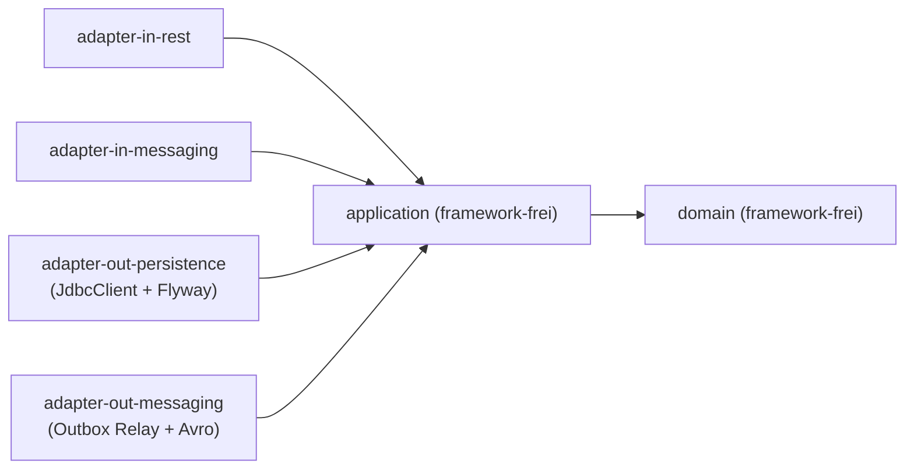

# ledger-stream

Event-getriebenes Buchungssystem in **Java 21** und **Spring Boot 3.5.x**, das messbar zeigt, wie effektive **Exactly-once-Verarbeitung** zwischen PostgreSQL 16 und Apache Kafka (KRaft) über **Transactional Outbox**, **idempotente Consumer** und **klassifiziertes Fehlerhandling mit DLQ & Replay** hergestellt wird.

## Problemstellung

Der schwierige Teil event-getriebener Systeme ist nicht das Produzieren einer Kafka-Nachricht. Die eigentliche Konsistenzaufgabe liegt an der Systemgrenze zwischen relationaler Datenbank und Broker:

- **Absturz nach DB-Commit, vor Kafka-Publish** → Buchung existiert, Event fehlt (Datenverlust im Downstream).
- **Absturz nach Kafka-Publish, vor Bestätigung / Redelivery** → Event kommt mehrfach an (Doppelbuchung ohne Idempotenz).
- **Doppelter Client-Request bei Netzwerk-Timeout** → ohne expliziten `Idempotency-Key` entsteht eine doppelte Buchung.

`ledger-stream` löst diese Probleme explizit und ohne verdeckende Bibliotheken (kein Debezium, kein Spring Cloud Stream, kein Axon, kein Lombok, kein JPA/Hibernate).

## Effektive Exactly-once-Semantik

In einem verteilten System aus PostgreSQL und Kafka existiert kein magisches „Exactly-once-Delivery“ über die Netzwerkgrenze. `ledger-stream` trennt deshalb bewusst drei Schichten:

| Schicht | Garantie | Mechanismus in `ledger-stream` |
|---|---|---|
| **Zustellung (Delivery)** | **At-least-once** | Transactional Outbox (`FOR UPDATE SKIP LOCKED`, Batch 500) publiziert nach Commit; Absturz zwischen Kafka-Ack und `markSent` führt zu erneutem Publish. |
| **Verarbeitung (Processing)** | **At-least-once** | Manuelles Offset-Commit erst nach DB-Commit; Absturz zwischen DB-Commit und Offset-Commit sowie Non-Blocking Retry Topics liefern Records erneut aus. |
| **Wirkung (Effect)** | **Genau einmal (Exactly-once)** | Schreibseite: `UNIQUE (account_id, idempotency_key)` + byte-gleiches Replay gecachter `2xx`-Antworten. Leseseite: `INSERT INTO processed_events ... ON CONFLICT DO NOTHING` in derselben Transaktion wie das `account_summary`-Update. |

## Architektur

Die vollständige Architektur inklusive Hexagonal-Schnitt und End-to-End-Sequenzdiagramm ist in [docs/architecture.md](docs/architecture.md) dokumentiert.



Architekturentscheidungen werden als ADRs unter [`docs/adr/`](docs/adr/) gepflegt:
- [ADR-0001: Spring `JdbcClient` statt JPA/Hibernate](docs/adr/0001-jdbcclient-statt-jpa.md)
- [ADR-0002: Avro-Kompatibilität `FULL` statt `BACKWARD`](docs/adr/0002-avro-full-compatibility-statt-backward.md)
- Bewusste Entwurfsgrenzen (u. a. Per-Account-Reihenfolge bei Non-Blocking Retry-Topics): [docs/design-decisions.md](docs/design-decisions.md)

## Idempotenz-Semantik (HTTP-API)

Jede schreibende Buchungsoperation (`POST /api/v1/accounts/{id}/bookings`, `POST /api/v1/accounts/{id}/bookings/{bookingId}/cancel`) erfordert den Header `Idempotency-Key` (1–128 Zeichen, eindeutig pro Konto über `UNIQUE (account_id, idempotency_key)`):

1. **Atomare Persistenz & Payload-Fingerprint:** Statuscode, serialisierter JSON-Response-Body und `request_fingerprint` (`CHAR(64)`, SHA-256 über die kanonischen Geschäftsfelder `accountId`, `type`, normalisierter `amount`, `currency`, `reference` — **nicht** über den rohen JSON-Body) werden in derselben Datenbanktransaktion wie die Konto- und Buchungsänderung in `idempotency_keys` persistiert.
2. **Byte-gleiches Replay (gleicher Fingerprint):** Ein wiederholter Request mit demselben `(account_id, idempotency_key)` **und** identischem `request_fingerprint` führt keinen zweiten Buchungseffekt aus und liefert den persistierten HTTP-Status sowie den **byte-identischen** Response-Body zurück (`Idempotency-Replayed: true`).
3. **Key-Reuse mit abweichendem Inhalt (`422`):** Wird derselbe `(account_id, idempotency_key)` mit **anderem** Inhalt (abweichender `request_fingerprint`, z. B. anderer Betrag) wiederverwendet, lehnt die API den Request mit HTTP **`422 Unprocessable Entity`** (RFC 7807 `type: urn:ledger-stream:error:idempotency-key-reuse`, `errorCode: IDEMPOTENCY_KEY_REUSE`) ab — keine zweite Buchung, Saldo unverändert.
4. **Nur `2xx` wird gecacht:** Ablehnungen (`400`, `404`, `422`) rollen die Transaktion zurück und werden **nicht** in `idempotency_keys` gespeichert (`CHECK (response_status BETWEEN 200 AND 299)`).
5. **Abgrenzung `409` / `503` vs. `422`:**
   - **Paralleler gleicher Request (gleicher Key & gleicher Inhalt):** Verlierer liest die Antwort des Gewinners und liefert sie byte-gleich zurück. Bei konkurrierendem Konflikt ohne abgelegte Idempotenz-Antwort (Optimistic Locking) entsteht **`409 Conflict`**; überschreitet das Warten auf den Zeilen-/Index-Lock `lock_timeout = 3s` (`SQLSTATE 55P03`), liefert die API **`503 Service Unavailable`** mit `Retry-After: 1` (`LOCK_TIMEOUT`).
   - **Gleicher Key mit anderem Inhalt:** deterministisch **`422 Unprocessable Entity`** (`urn:ledger-stream:error:idempotency-key-reuse`).

## Outbox-Betrieb, Metriken & PostgreSQL-Parameter

### Outbox-Alarmierung (Prometheus-Beispiel)

Ein reiner Zähler wie `outbox_unsent` reicht nicht aus, um ein stehendes Relay von normalem Last-Backlog zu unterscheiden. Entscheidend ist das Alter des ältesten `PENDING`-Events (`outbox_oldest_pending_age_seconds`):

```yaml
- alert: OutboxRelayStalled
  expr: outbox_oldest_pending_age_seconds > 300
  for: 1m
  labels:
    severity: critical
  annotations:
    summary: "Outbox-Relay hängt oder ist ausgefallen"
    description: "Ältestes PENDING-Outbox-Event wartet seit > 300s (Wert: {{ $value }}s)."
```

Weitere Outbox-Metriken: `outbox_unsent` (Micrometer: `outbox_unsent_total`), `outbox_events_failed_total` (Events im Status `FAILED` nach `N=10` fehlgeschlagenen Versuchen mit exponentiellem Backoff `1s..60s` ±20 % Jitter).

### Verifizierte PostgreSQL-Parameter (Docker Compose)

Nach Start von `postgres` per `SHOW` bestätigt:

```text
shared_buffers       = 64MB
work_mem             = 4MB
maintenance_work_mem = 32MB
lock_timeout         = 3s
```

## Fehlerbehandlung, Non-Blocking Retry & DLQ

### Warum Retry-Topics (`@RetryableTopic`) statt `DefaultErrorHandler`-Backoff oder Pause/Resume?

- Ein blockierender `DefaultErrorHandler` mit `ExponentialBackOff` schläft direkt im Consumer-Thread und **blockiert alle nachfolgenden Events derselben Partition** — zudem droht bei längeren Backoffs ein Überschreiten von `max.poll.interval.ms` (`300000 ms` = 5 min) und damit ungewollte Consumer-Group-Rebalances.
- Ein manuelles `pause()`/`resume()` auf Partitionsebene stoppt ebenfalls die gesamte Partition (Head-of-Line-Blocking) und verkompliziert Offset-Management sowie Rebalance-Handling erheblich.
- **Retry-Topics (`ledger.events-retry-0..3` → `ledger.events.dlq`)** verschieben fehlerhafte technische Nachrichten sofort asynchron aus dem Haupt-Topic und committen dessen Offset, sodass nachfolgende Nachrichten derselben Partition verzögerungsfrei weiterlaufen und `max.poll.interval.ms` nie gefährdet wird.

### Fehlerklassifikation & Metriken

- **Deserialisierungsfehler & fachliche Fehler** (`unknown_account`, `amount <= 0`, ungültiger Typ): **0 Retries**, direkt in `ledger.events.dlq` und `dlq_entries` unter Beibehaltung der unveränderten Rohbytes (`RawPayloadPreservingAvroDeserializer`, Base64 in Header `x-original-payload`).
- **Technische Fehler** (DB-Ausfall, Timeout, Schreibfehler): nicht-blockierend bis zu **5 Versuche** mit exponentiellem Backoff und Jitter (`random = true`), danach `ledger.events.dlq` + `dlq_entries`.
- **Metriken (`/actuator/prometheus`):**
  - `dlq_entries_unhandled` (Gauge): offene DLQ-Einträge (`replayed_at IS NULL`) — Zielwert `0`, maßgeblich für Alarmierung.
  - `dlq_replayed_total` (Counter): über `POST /admin/dlq/{id}/replay` erneut eingestellte Einträge.
  - `consumer_retries_total` (Counter): ausgelöste nicht-blockierende Retry-Versuche (Frühindikator vor DLQ-Wachstum).
- **Admin-Endpunkte abgesichert (Phase 7):** `GET /admin/dlq` und `POST /admin/dlq/{id}/replay` erfordern `ledger.admin.enabled=true` **und** ein gültiges OIDC-Token mit Rolle `operator` (`ROLE_operator`). Standardmäßig (`ledger.admin.enabled=false`, auch im k3s-Overlay [deploy/kustomize/overlays/prod/kustomization.yaml](deploy/kustomize/overlays/prod/kustomization.yaml) explizit gepinnt) liefern sie `404` vor `401`.
- **Zwei unabhängige Replay-Garantien & unveränderliche Replay-Historie:** Ein erneuter Replay eines bereits wieder eingespielten DLQ-Eintrags wird an der Admin-API über den `replayed_at`-Guard mit HTTP **`409 Conflict`** abgewiesen; selbst bei einem manuellen Re-Publish am Admin-Endpunkt vorbei verhindert `UNIQUE (event_id)` auf `processed_events` eine doppelte Buchungswirkung. Jeder Replay-Versuch wird unveränderlich in `dlq_replay_attempts` protokolliert; scheitert ein Replay erneut oder trifft derselbe unlesbare Deserialisierungs-Poison mehrfach ein, dedupliziert der Partial-Unique-Index `uq_dlq_entries_unhandled_dedup_key` auf `COALESCE(event_id::text, payload_sha256) WHERE replayed_at IS NULL` in eine einzige offene Zeile und erhöht `attempt_count`.
- Vollständiges Runbook (Analyse, Replay-Kriterien, Begründung Outbox `10` vs. Consumer `5` Retries): [docs/operations.md](docs/operations.md).

## Security (Keycloak 26 + OIDC Resource Server)

### Rollenmodell (Least Privilege)

| Rolle | Authority | Erlaubte Endpunkte | Bewusst verweigert (`403`) |
|---|---|---|---|
| `viewer` | `ROLE_viewer` | `GET /api/v1/accounts/**` | `POST /api/v1/accounts/**`, `/admin/dlq/**` |
| `writer` | `ROLE_writer` | `GET` & `POST /api/v1/accounts/**` (Kontoanlage, Buchung, Storno) | `/admin/dlq/**` |
| `operator` | `ROLE_operator` | `GET` & `POST /api/v1/accounts/**` sowie `/admin/dlq/**` (bei `ledger.admin.enabled=true`) | — |

**Entscheidung:** Drei Rollen statt zwei — Buchungs-Clients (`writer`) können geschäftliche Buchungen ausführen, dürfen aber niemals DLQ-Payloads inspizieren oder Replays auslösen (`Separation of Duties`).

### Durchsetzung & Härtung

- **404-vor-401-Invariante:** Ist `ledger.admin.enabled=false` (Default), schneidet eine `@Order(1)`-`SecurityFilterChain` **jede** Route unter `/admin/**` noch vor der OIDC-Prüfung ab und liefert RFC-7807 **`404 Not Found`** (unauthentifiziert, als `viewer` und als `operator`) — selbst dann, wenn unter `/admin/**` ein Controller ohne `@ConditionalOnProperty` registriert wäre (abgesichert über `AdminPathInvariantDisabledIT`/`AdminPathInvariantEnabledIT` mit Testprofil-Route `/admin/test-only`).
- **Explizite Token-Prüfung & Allowlist-Rollen-Mapper:** `JwtAuthenticationConverter` mappt ausschließlich die Allowlist `{viewer, writer, operator}` aus `realm_access.roles` auf `ROLE_*` und verwirft technische Keycloak-Rollen (`default-roles-*`, `offline_access`, `uma_authorization`). Der `NimbusJwtDecoder` prüft Signatur über JWKS (kein `alg=none`, kein fremder Key), `exp`/`nbf`, `iss` sowie explizit `aud = ledger-stream-api`. `401` und `403` liefern strukturierte RFC-7807-Antworten (`application/problem+json`).
- **CORS:** Explizite Origin-Allowlist (`ledger.security.cors-allowed-origins`, kein `*` bei `allowCredentials=true`), `Allow-Headers` inkl. `Authorization` und `Idempotency-Key`, Preflight für `POST` verifiziert.
- **Keine Secrets im Repository & Testinfrastruktur-Markierung:** [keycloak/realm-export.json](keycloak/realm-export.json) enthält den Public-PKCE-Client `ledger-stream-spa` (`S256`, ohne Secret) sowie den vertraulichen Client `ledger-stream-cli` mit Platzhalter `${LEDGER_CLI_CLIENT_SECRET}` (Injektion per Env / Kubernetes `secretKeyRef` in [deploy/kustomize/base/keycloak-deployment.yaml](deploy/kustomize/base/keycloak-deployment.yaml)). `ledger-stream-cli` mit `directAccessGrantsEnabled=true` dient ausschließlich als Test- und CI-Infrastruktur; produktive Benutzer-Logins erfolgen ausschließlich über `ledger-stream-spa` (Authorization Code + PKCE `S256`).

## Frontend (Vue 3 + TypeScript + Vite + `oidc-client-ts`)

- **Idempotency-Key-Lebenszyklus (`frontend/src/composables/useBookingForm.ts`):** Der `Idempotency-Key` entsteht per `crypto.randomUUID()` beim **Öffnen** des Buchungsformulars, ist im Formular sichtbar und kopierbar und wird **niemals** im Submit-Handler erzeugt. Erst nach bestätigter `2xx`-Antwort wird ein neuer Key gezogen; „Erneut senden (gleicher Key)“ sowie parallele Doppelklicks behalten exakt denselben Key.
- **Kein deaktivierter Submit-Button:** Während laufender Requests zeigt der Submit-Button einen Spinner (`aria-busy="true"`) statt `disabled`, ergänzt um **„Absichtlich doppelt senden (2× parallel)“** mit Live-Doppelklick-Protokoll (2 Requests, 1 Buchung, byte-gleicher Response-Body).
- **Geld als String (`frontend/src/utils/money.ts`):** `BigDecimal`-Werte werden vom Backend als JSON-Strings (`@JsonFormat(shape = STRING)`) geliefert und direkt per `Intl.NumberFormat('de-DE', { style: 'currency', currency })` formatiert — ohne `number`-Parsing und ohne Arithmetik.
- **Token-Lifecycle & Sichtbarkeit:** `automaticSilentRenew`, explizite Re-Login-Ansicht bei abgelaufenem Token (kein leerer Bildschirm), Logout über `end_session_endpoint`, fünf sichtbare Fehlerzustände (`401`, `403`, `422` RFC-7807 Feldfehler, `409`/Idempotenz-Replay, Netzwerk mit Retry) sowie `document.visibilityState`-gesteuertes Polling mit Backoff und `clearInterval` in `onUnmounted`.
- **Strikte Typisierung:** `strict`, `noUncheckedIndexedAccess`, `exactOptionalPropertyTypes`, ESLint `@typescript-eslint/no-explicit-any: error` und `consistent-type-assertions: never` (0 `any`, 0 `as unknown as X`).

## Observability (Micrometer, Prometheus, Grafana, JSON-Logging & Correlation-ID)

- **Micrometer-Metriken (`/actuator/prometheus`, strikt begrenzte Kardinalität):** Ausschließlich geschlossene Label-Mengen (`outcome`, `reason`, `type`, `result`) — **niemals** `accountId`, `eventId`, `correlationId` oder Beträge als Metrik-Tag. Exponiert u. a. `outbox_unsent`, `outbox_oldest_pending_age_seconds`, `outbox_events_failed_total`, `outbox_events_relayed_total{type,result}`, `consumer_processed_total{outcome}`, `consumer_duplicates_rejected_total{reason}`, `consumer_retries_total`, `dlq_entries_unhandled`, `dlq_replayed_total`, `http_server_requests_seconds` (inkl. Histogram-Buckets).
- **Prometheus & Grafana (Zero-Click-Provisioning):** [observability/prometheus.yml](observability/prometheus.yml) scrapt `app:8080/actuator/prometheus` und `keycloak:9000/metrics` mit `--storage.tsdb.retention.time=2d --storage.tsdb.wal-compression`. [observability/grafana/provisioning/datasources/prometheus.yml](observability/grafana/provisioning/datasources/prometheus.yml) provisioniert die Datasource mit fester `uid: prometheus`; [observability/grafana/dashboards/ledger-stream.json](observability/grafana/dashboards/ledger-stream.json) (`uid: ledger-stream-overview`, 8 Panels inkl. roter 300s-Schwelle auf `outbox_oldest_pending_age_seconds` sowie separater HTTP-**p95**- und **p99**-Panels mit `uri!~"/actuator.*"` und `sum by (le, uri)`) referenziert diese UID ohne `__inputs`.
- **Strukturiertes JSON-Logging & 3-stufige Correlation-ID:** [logback-spring.xml](app/src/main/resources/logback-spring.xml) (`logstash-logback-encoder`) schreibt flaches JSON (`ts`, `level`, `logger`, `message`, `correlationId`, `eventId` nur im Event-Kontext; keine Tokens, `Authorization`-Header oder Roh-Payloads). `CorrelationIdFilter` validiert eingehende `X-Correlation-Id` strikt gegen `^[A-Za-z0-9._-]{8,64}$` (ungültige Werte werden verworfen, mit neuer UUID ersetzt und `correlationIdRejected=true` geloggt), persistiert sie in `outbox_events.correlation_id`, überträgt sie per Kafka-Header in den Consumer (`MDC` + `finally MDC.clear()`) und erhält sie beim DLQ-Replay.

## Ressourcenbudget (gemessene `docker stats` — Leerlauf & 100k-Peak, ALLE 8 Container)

Keycloak 26 läuft mit `start --optimized --import-realm`, `-Xmx256m`, `KC_CACHE=local` auf der **bestehenden** PostgreSQL-16-Instanz (eigene Datenbank `keycloak`, kein H2, kein Dev-Mode). Gemäß L1 wurde `ledger-stream-app` vor dem 100k-Lastlauf auf `512 MiB` (`-XX:MaxRAMPercentage=60.0` ≈ `307 MiB` Heap + Non-Heap-Reserve) angehoben und der **Peak-RSS während des 100.000-Buchungen-Lastlaufs** (2s-Sampling über `docker stats`) gegen den Leerlauf gemessen:

| Container | Limit | Tuning | RSS Leerlauf | RSS Peak (100k-Lauf #1) | Peak-Auslastung |
|---|---:|---|---:|---:|---:|
| `ledger-stream-postgres` | `320 MiB` | `shared_buffers=64MB`, `work_mem=4MB`, `max_connections=60`, `lock_timeout=3s` (`ledger` + `keycloak`) | `55,13 MiB` | `260,30 MiB` | `81,36 %` |
| `ledger-stream-kafka` | `448 MiB` | KRaft, 6 Partitionen, `-Xms128m -Xmx192m`, `dedupe_buffer=16MB` | `213,50 MiB` | `294,40 MiB` | `65,72 %` |
| `ledger-stream-schema-registry` | `384 MiB` | `FULL`, `-Xmx192m -XX:MaxMetaspaceSize=96m` | `198,70 MiB` | `222,20 MiB` | `57,86 %` |
| `ledger-stream-keycloak` | `640 MiB` | `start --optimized`, `KC_DB=postgres`, `KC_CACHE=local`, `KC_METRICS_ENABLED=true`, `-Xms128m -Xmx256m` | `400,00 MiB` | `416,60 MiB` | `65,09 %` |
| `ledger-stream-app` | `512 MiB` | Java 21 JRE, `-XX:MaxRAMPercentage=60.0 -XX:+UseG1GC`, Consumer-Concurrency `6`, Relay `500/200ms` | `272,10 MiB` | `488,40 MiB` | `95,39 %` |
| `ledger-stream-frontend` | `48 MiB` | `nginxinc/nginx-unprivileged:1.27-alpine` (statisches Vue-Bundle) | `16,29 MiB` | `19,00 MiB` | `39,58 %` |
| `ledger-stream-prometheus` | `192 MiB` | `--storage.tsdb.retention.time=2d --storage.tsdb.wal-compression` | `21,68 MiB` | `24,57 MiB` | `12,80 %` |
| `ledger-stream-grafana` | `192 MiB` | `GF_INSTALL_PLUGINS=""`, `GF_ANALYTICS_CHECK_FOR_UPDATES=false` | `69,55 MiB` | `77,31 MiB` | `40,26 %` |
| **Summe gemessen (alle 8 Container)** | — | **Zielbudget Leerlauf: `1536 MiB` (1,5 GiB)** | **`1246,95 MiB`** *(Puffer `+289,05 MiB`)* | **`1802,78 MiB`** *(Peak-Burst `+266,78 MiB` über 1,5 GiB)* | **0 OOMKills** |

> **Befund aus der Lastmessung:**
> - **Keycloak (P1):** Peak `416,60 MiB` (`< 450 MiB`) → `-Xmx256m` bleibt ausreichend.
> - **App (L1):** Kein OOMKill über 2 × 100.000 Buchungen (`Peak 488,40 MiB / 512 MiB` in Lauf #1, `469,80 MiB / 512 MiB` in Lauf #2). Da `95,39 %` im Dauer-Burst knapp am Container-Limit liegen, wird im k3s-Produktions-Overlay (Phase 11) `limits.memory: 640Mi` eingeplant.
> - **Summe im 100k-Burst:** Der Anstieg von `1246,95 MiB` (Leerlauf) auf `1802,78 MiB` (Peak) resultiert aus PostgreSQL-Page-Cache/WAL (`+205 MiB`), App-Heap/Netty/Kafka-Puffern (`+216 MiB`) und Kafka-Page-Cache (`+81 MiB`). Beide Werte werden getrennt ausgewiesen.

## Schema-Evolution (Avro + Confluent Schema Registry)

- **Kompatibilitätsstufe:** `FULL` (beidseitig: v2-Consumer liest v1-Daten **und** v1-Consumer liest v2-Daten; Begründung gegenüber `BACKWARD` und `FULL_TRANSITIVE` in [ADR-0002](docs/adr/0002-avro-full-compatibility-statt-backward.md)).
- **Evolution v1 → v2 (`LedgerBookingEvent.avsc`):** Neues optionales Feld `initiationChannel` (`"type": "string", "default": "API"`). Beim Lesen älterer v1-Nachrichten löst der Consumer den nicht-null Default `"API"` auf; `schemaVersion = 2` im Payload korrespondiert mit der v2-Schema-ID im 5-Byte Confluent-Wire-Header.
- **CI-Erzwingung:** `SchemaEvolutionIT` prüft im CI-Build gegen eine echte Schema Registry (`confluentinc/cp-schema-registry:7.9.9`) die `FULL`-Konfiguration, beide Leserichtungen, die Ablehnung eines inkompatiblen Schemas (Pflichtfeld ohne Default → HTTP `409`) sowie byte-gleiche Rohbytes bei DLQ-Replay von v2-Events. Der CI-Workflow bricht ab, falls `SchemaEvolutionIT` nicht mit 0 Skips läuft.

## Schnellstart

```bash
# 1. Lokale Infrastruktur starten (PostgreSQL 16, Kafka 3.9.1 KRaft, Schema Registry)
docker compose up -d --wait

# 2. Build, ArchUnit-Prüfung und Testcontainers-Integrationstests ausführen
./mvnw verify
```

> Hinweis: PostgreSQL in `docker-compose.yml` ist standardmäßig nur innerhalb des Compose-Netzwerks erreichbar (kein Host-Port-Mapping). Alle Integrationstests laufen vollständig isoliert über Testcontainers.

## Lastnachweis (Phase 10 — 100.000 Buchungen, reproduzierbar)

> **Klare Trennung der Nachweise:**
> - **Retry-Leiter (5 Versuche, exponentieller Backoff + Jitter):** nachgewiesen über dedizierten Integrationstest (`DlqAndRetryIT`, Phase 5), nicht über den Lasttest.
> - **Duplikat-Kohorte (5 %, L2):** echte Replays bereits akzeptierter Anfragen aus einem Ringpuffer (`Idempotency-Key` + identischer Payload → `201 Created` + `Idempotency-Replayed: true`, byte-identischer Body, keine zweite Buchung, kein zweites Kafka-Event → `consumer_duplicates_rejected_total{reason="duplicate"} == 0`). Consumer-seitige Duplikat-Abweisung (`UNIQUE(event_id)`) ist separat in `IdempotentConsumerIT` nachgewiesen.
> - **DLQ-Anteil im Lasttest (1 %):** transportseitige Fault Injection (schema-valide Avro-v2-Poison-Events — 50 % `unknown_account`, 50 % `non_positive_amount` — direkt ins Topic `ledger.events` durch `load-generator`), kein Test-Schalter im Produktivcode.
> - **Aufwärmphase:** erste `5 s` gegen dedizierte Warmup-Konten, vollständig aus Durchsatz- und Latenzwerten ausgeschlossen (in der Gesamt-DB-Invariante jedoch exakt gegen `bookings` und `processed_events` mitgeprüft).

### Umgebung & Reproduzierbarkeits-Parameter (L6)

| Parameter | Wert |
|---|---|
| **Host-Hardware** | Intel Core Ultra 7 155H (`22` vCPU / 11 Kerne × 2 Threads), `31 GiB` RAM, `1 TB` virtuelle Disk (`/dev/sdd`), virtualisiert (`WSL2` / Microsoft Hypervisor) |
| **Container-Konfiguration** | `docker-compose.yml` + `docker-compose.loadtest.yml` (identische `mem_limit`-Werte wie oben; CPU-Caps für den Lastlauf entdrosselt: `app: 6.0`, `postgres: 4.0`, `kafka: 2.0`, `keycloak: 2.0`, `schema-registry: 1.0`) |
| **JVM (App-Container)** | `eclipse-temurin:21-jre-alpine`, `JAVA_OPTS="-XX:MaxRAMPercentage=60.0 -XX:+UseG1GC -XX:+ExitOnOutOfMemoryError"` (`512 MiB` Limit → `~307 MiB` Heap) |
| **JVM (Client `load-generator`)** | `OpenJDK 25.0.2 LTS (Corretto-25.0.2.10.1)` (kompiliert mit `--release 21`), `-Djdk.httpclient.keepalive.timeout=60` |
| **Kafka-Partitionen & Consumer (L3a)** | `ledger.events`: **6 Partitionen**, `ledger.events.dlq`: **6 Partitionen**, Consumer-Concurrency: **`6`** (`KAFKA_CONSUMER_CONCURRENCY=6`) |
| **Outbox-Relay-Deckel (L3b)** | Batch `500`, Poll-Intervall `200 ms` (`OUTBOX_RELAY_FIXED_DELAY_MS=200`, theoretischer Deckel `2.500 Events/s`; Wave-basiertes Kafka-Pipelining je distinktem Konto) |
| **Client-Setup (L3c)** | `load-generator` CLI (ohne Spring-Kontext), `--threads=32`, `128` vorangelegte Benchmark-Konten, HTTP/1.1 Keep-Alive Connection-Pool |
| **Aufruf (reproduzierbar)** | `java -Djdk.httpclient.keepalive.timeout=60 -jar load-generator/target/load-generator-0.1.0-SNAPSHOT-shaded.jar --bookings=100000 --duplicates=0.05 --poison=0.01 --seed=20261124 --threads=32 --warmup-seconds=5 --base-url=http://127.0.0.1:8085` |

### Ergebnisse (zwei unabhängige Läufe mit identischem Seed `20261124`)

| Lauf | Gesendet (Regulär / Dup / Poison) | Akzeptiert (DB-Diff) | Validierung abgelehnt | L2-Duplikate replayed (`201` + Header) | Consumer-Duplikate (`reason="duplicate"`) | DLQ-Einträge (Diff) | Dauer (ohne 5s Warmup) | Durchsatz HTTP (akzept. Buchungen/s) | Durchsatz Consumer (Prometheus 2m-Peak) | Invarianten-Check | Seed |
|---|---:|---:|---:|---:|---:|---:|---:|---:|---:|---|---:|
| **Lauf #1** | `106.000` (`100.000` / `5.000` / `1.000`) | `100.000` *(Diff `0`)* | `0` | `5.000` *(0 Mismatch)* | `0` | `1.000` *(Diff `0`)* | `211,26 s` | `473,3 /s` *(497,0 HTTP/s)* | `417,3 Events/s` *(6 Part., Conc. 6)* | **PASS** (`EXIT 0`, 10/10 Konten exakt) | `20261124` |
| **Lauf #2** | `106.000` (`100.000` / `5.000` / `1.000`) | `100.000` *(Diff `0`)* | `0` | `5.000` *(0 Mismatch)* | `0` | `1.000` *(Diff `0`)* | `199,55 s` | `501,1 /s` *(526,2 HTTP/s)* | `466,9 Events/s` *(6 Part., Conc. 6)* | **PASS** (`EXIT 0`, 10/10 Konten exakt) | `20261124` |

### Latenzvergleich: Clientseitig (`load-generator`) vs. Serverseitig (Prometheus `http_server_requests_seconds`)

| Lauf | Messpunkt | p50 | p95 | p99 |
|---|---|---:|---:|---:|
| **Lauf #1** | **Client** (`load-generator`, regulär / alle HTTP) | `56,39 ms` / `55,30 ms` | `128,60 ms` / `127,32 ms` | `183,24 ms` / `181,89 ms` |
| **Lauf #1** | **Server** (Prometheus `POST /api/v1/accounts/{accountId}/bookings`, `5m`-Fenster) | `37,57 ms` | `87,87 ms` | `131,23 ms` |
| **Lauf #2** | **Client** (`load-generator`, regulär / alle HTTP) | `51,11 ms` / `50,09 ms` | `131,30 ms` / `130,02 ms` | `191,57 ms` / `190,02 ms` |
| **Lauf #2** | **Server** (Prometheus `POST /api/v1/accounts/{accountId}/bookings`, `5m`-Fenster) | `35,02 ms` | `87,77 ms` | `136,47 ms` |

> **Determinismus-Nachweis (Seed `20261124`):** Beide Läufe auf frisch zurückgesetzten Stacks liefern exakt identische Kohortenzahlen (`100.000` / `5.000` / `1.000`), exakt `0` Abweichung auf allen 5 Invarianten sowie centgenau identische Endsalden auf allen 10 Stichprobenkonten (z. B. `DE-BENCH-1352904-0000 = 11737.39 EUR`, `DE-BENCH-1352904-0001 = 12307.11 EUR`, …, `DE-BENCH-1352904-0009 = 12112.79 EUR`, je `782/782` Buchungen).
