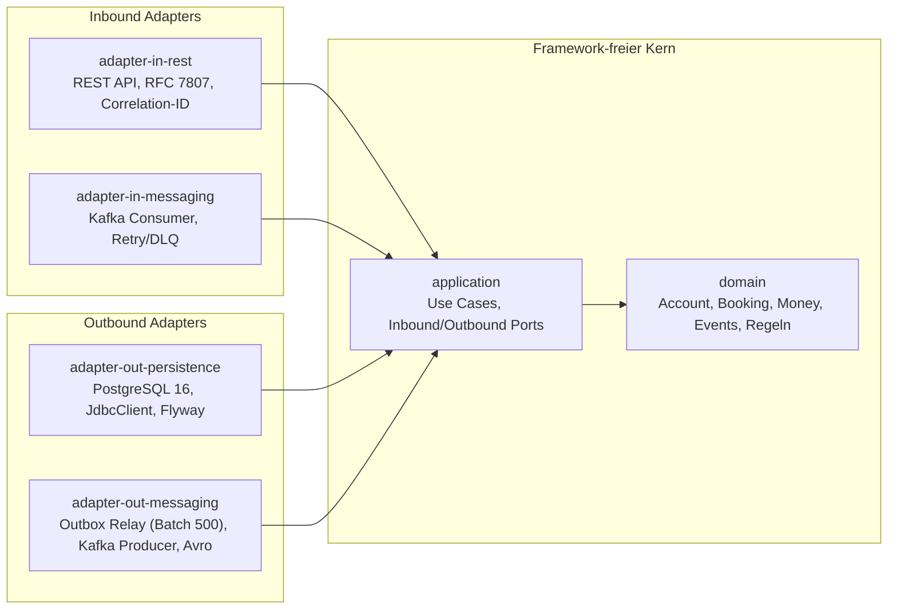
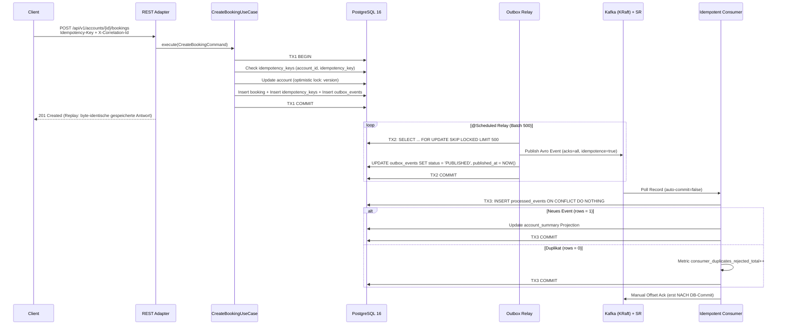

# Architektur von `ledger-stream`

## Hexagonal Architecture (Ports & Adapters)

Die Schichttrennung wird durch ArchUnit ([`HexagonalArchitectureTest`](../app/src/test/java/io/ledgerstream/app/architecture/HexagonalArchitectureTest.java)) und das `maven-enforcer-plugin` im Build erzwungen:

- `domain` und `application` sind vollständig framework-frei (keine Spring-, Jakarta-, Kafka- oder Avro-Imports).
- `adapter-in-*` und `adapter-out-*` kommunizieren ausschließlich über Ports in `application` und kennen einander nicht.
- Transaktionsgrenzen werden explizit über den Port `TransactionRunner` gesteuert (`PROPAGATION_REQUIRED`).

## End-to-End-Konsistenzfluss (Outbox & Idempotenter Consumer)

